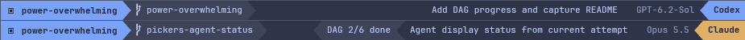
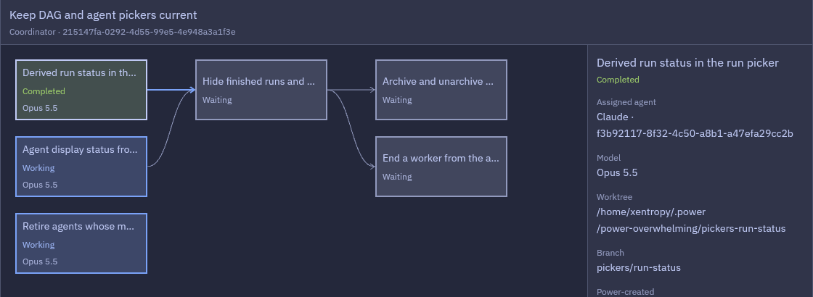
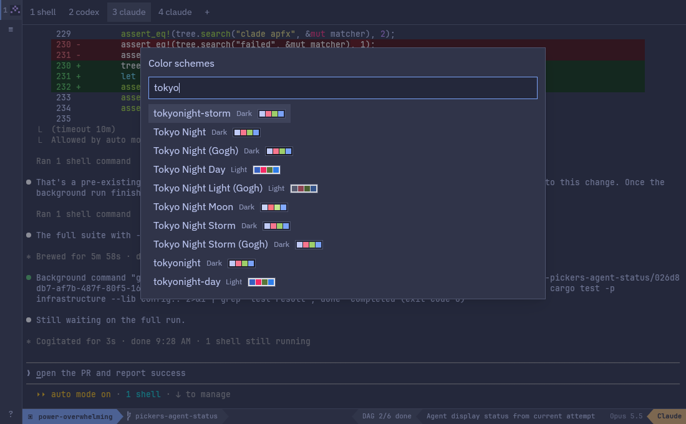
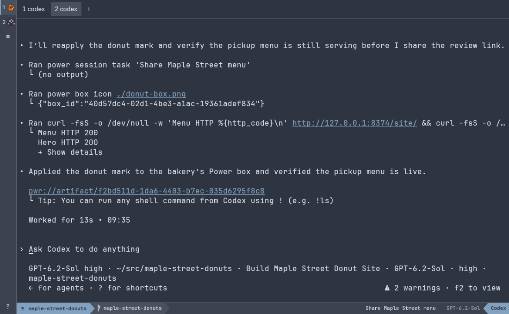
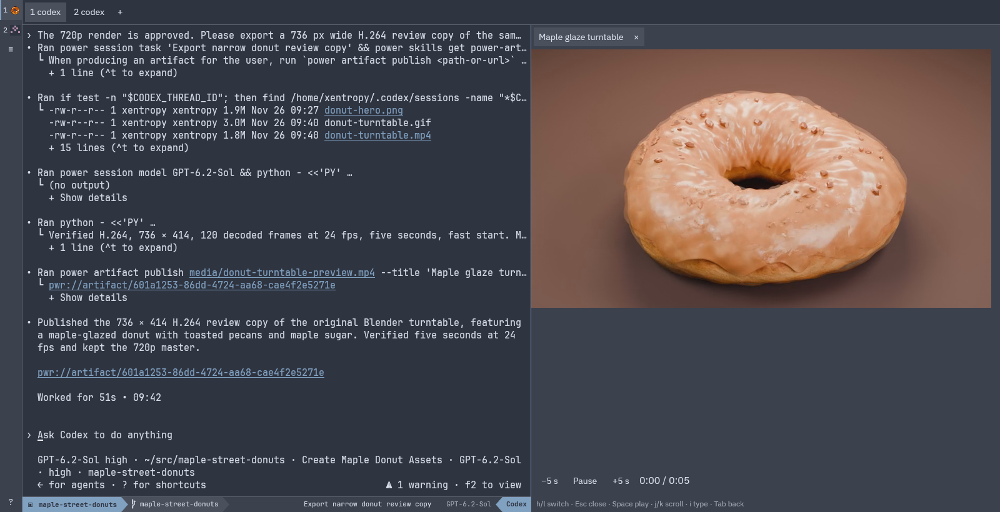
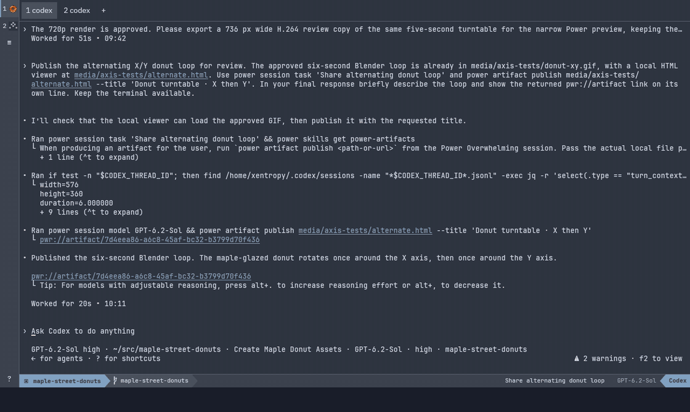
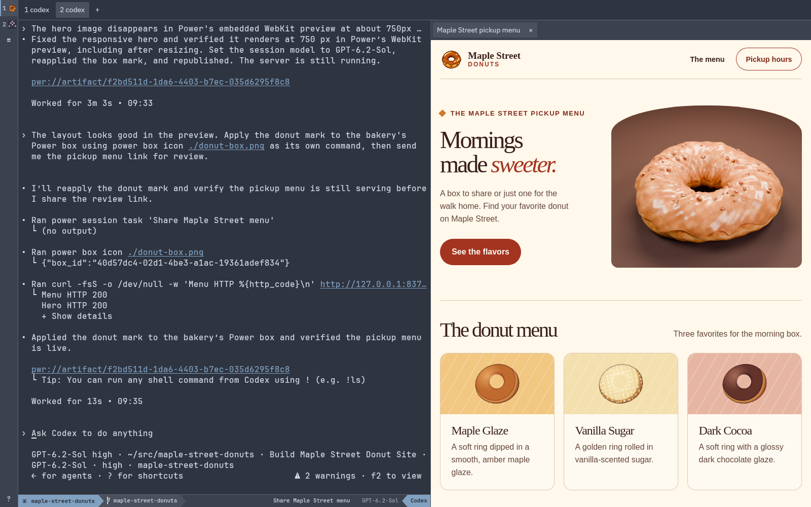

# Power Overwhelming

Power is a native Wayland desktop multiplexer for coding agents such as Claude Code, Codex, Grok, and jcode. Close the GPUI window and the local daemon keeps your terminals and agents running. Artifact links open in a preview pane you can close independently of the terminal.

Contributions are welcome. See the [contribution guide](CONTRIBUTING.md) for the project's design principles and how to get started.

## Feature tour

### Agent status at a glance

The bundled [Power-bar plugin](#power-bar) puts the active worktree, task label, model, and agent type in the same places across providers. The top bar shows Codex working on this README. The bottom bar shows a Claude Code worker in a separate worktree and its DAG progress.



### Live DAG orchestration

Coordinators [dispatch workers and track dependencies](#dag-orchestration) in Power. In the run below, the run-status change is complete. Two workers are active and their dependent tasks are waiting. Select a node to inspect its attempt or open the worker's terminal.



### Theme picker

Press Ctrl+B then `t` to search [color schemes](#color-schemes) and see their palettes. The selected scheme applies to the app and its terminals.



### Boxes and tabs

The Maple Street Donuts box groups two sessions, one for the product render and one for the pickup menu. The menu agent drew the donut icon and set it in the box rail with `power box icon ./donut-box.png`.



### Video and web previews

One Codex session modeled a maple-glazed donut in Blender and [published a review copy of the turntable](#preview-an-artifact). Open the link from that session to play the video beside the agent's final response.



To open the alternating turntable from the keyboard, press Ctrl+S, then `o`, then the number shown on the artifact link. In this session, the link is `1`.




The other Codex session used a still from that render on the pickup menu. It ran a local server and published the page, so the link opens the live menu beside the conversation.



## Build and run

Use Rust 1.97 or later and Zig 0.17.x. The Linux build uses a C compiler, pkg-config, WebKitGTK 4.1, JSON-GLib, and GStreamer application and video libraries. Playback also needs GStreamer codecs for MP4 and WebM. GPUI requires a working Vulkan driver.

```sh
mise run release
./target/release/power gui
```

Run `power` or `power gui` from any directory. Enter a Git checkout path in the picker to create a box with a shell tab. Tab completes the selected result. Enter opens it.

The picker searches up to six directory levels below the path before the last separator. It uses fzf's matching algorithm and query syntax. Every space-separated term must match, and `'exact`, `^prefix`, `suffix$`, and `!exclude` work as in fzf. Lowercase queries ignore case. Matches in the final folder name rank first. The search skips hidden directories, paths excluded by `.gitignore`, `node_modules`, and `target`.

Type `codex`, `claude`, or `grok` in the shell to start an installed agent. Tab labels show the number and what's running, such as `1 shell` or `2 claude`. They update when an agent starts or exits.

## Shell integration

On first launch, Power offers to add one line to your shell's rc file (`~/.bashrc`, `~/.zshrc`, or fish's `config.fish`). The line defines a shell function for each agent profile only inside Power terminals. Profiles with launch instructions tell agents how to load the bundled skills. See [Skills](#skills).

To install the integration later, press `ctrl-b i` in the app or run `power setup`. Preview the change with `power setup --dry-run`. To remove it, delete the line and the comment above it.

After a daemon restart or reboot, Power restores each open session with its original ID and worktree. Shells reopen in their last directory with their scrollback. Agents with a `resume` spec pick up their conversations, including agents started from a shell with the integration installed. See [Agent profiles](#agent-profiles). Power skips one-off commands and drops sessions whose worktree is gone. Closing a tab ends its session. When the GUI reopens, it shows the last box and its active tab.

Press and release Ctrl+B for box commands or Ctrl+S for tab commands, then press the command key. Ctrl+B then `?` lists the shortcuts. Ctrl+B then `p` opens the command palette: type to fuzzy-search every box and tab command, with the three you ran most recently listed first. Ctrl+B then `x` detaches a box and Ctrl+B then `s` reopens it. Ctrl+S then `c` opens a shell tab, `t` picks an existing worktree, `r` recovers an unassigned session in the repository, and `x` opens the end-session confirmation. Use `power session list` and `power session end <id>` to manage sessions from the CLI.

## Skills

Power ships `power-dag` for DAG orchestration and `power-artifacts` for publishing previews. The skills live in the `power` binary. You can read the guides for your installed release with the daemon stopped.

```sh
power skills list                           # name and description of each skill
power skills get power-dag                  # the guide
power skills get power-dag --references     # list reference names
power skills get power-dag --reference worker-contract
power skills get power-dag --full           # guide plus every reference
```

Add `--json` to any of these for machine-readable output.

### Discovery

`power --help`, `power dag --help`, and `power skills --help` point agents to `power skills list`. For profiles with launch instructions, Power also names the bundled skills and tells the agent how to load them. This applies to the shell wrapper, `power session start`, and `power dag dispatch`. Power skips skills already in the agent's native skill folder and asks the agent to report its task and active model.

### Native installs

`power skills install` writes a small stub `SKILL.md` for each bundled skill so agents can find it without Power's launch instructions. The stub tells the agent to load the full guide with `power skills get <name>`, so installs stay current when Power updates.

```sh
power skills install --dry-run   # show what would change
power skills install             # user scope: ~/.agents/skills
power skills install --local     # project scope: .agents/skills in the current Git worktree
power skills update              # refresh existing installs; never adds new locations
```

Stubs go in the shared `.agents/skills` folder, which Codex and Grok read natively. For every other detected agent profile with a `skills_dir`, Power links `<skills_dir>/<name>` to the shared stub. In user scope an agent counts as detected when the parent of its `skills_dir` exists (for Claude Code, `~/.claude`). In project scope the worktree must already contain the profile's skill folder, such as `.claude/skills`. Use `--skill <name>` to select skills and `--agent <id>` to select profiles by ID, or `--agent universal` for the shared folder alone. `--json` prints each location's outcome.

Power only replaces what it wrote. It rewrites a stub when the file matches a stub from some Power release, and replaces a link only when it points at the shared copy. A stub you edited, a folder with other files, or a skill another package installed under the same name is left alone with a warning. Pass `--force` to replace those. Power moves the old copy to `~/.agents/.power-skill-backups` first.

## Agent profiles

Power provides `claude`, `codex`, `grok`, and `jcode` profiles. Pass a profile ID to `power session start`, `power agent start --provider`, or `power dag dispatch --provider`. With shell integration, use the ID as a command inside a Power terminal.

Add profiles or override built-in fields in `${XDG_CONFIG_HOME:-~/.config}/power-overwhelming/config.lua`. For example, this sets every field of the Grok profile. The built-in profile skips more subcommands.

```lua
agents.grok = {
  command = "grok",
  injection = { kind = "flag", flag = "--rules" },
  skip_subcommands = { "login", "logout", "mcp", "update", "version" },
  skip_if_args_contain = { "--rules" },
  skills_dir = "~/.agents/skills",
  resume = {
    assign = { "--session-id", "{id}" },
    resume = { "--resume", "{id}" },
    resume_last = { "--continue" },
    conflicts = { "--session-id", "-s", "--resume", "-r", "--continue", "-c", "--fork-session" },
  },
}
```

A new profile for another agent, and an override of one built-in field:

```lua
agents["my-agent"] = {
  command = "/opt/bin/my-agent",
  injection = { kind = "flag", flag = "--append-system-prompt" },
  skip_subcommands = { "login", "version" },
  skip_if_args_contain = { "--append-system-prompt" },
  skills_dir = "~/.my-agent/skills",
}

agents.codex = { command = "/opt/bin/codex" }
```

For a new profile, `command` defaults to the ID and `injection` defaults to `{ kind = "none" }`. Use the executable's name on PATH or an absolute path. Profile IDs use lowercase letters, digits, hyphens and underscores and start with a letter or digit. Power reserves `shell`, `command`, and `power`.

Use `{ kind = "config_value", flag = "-c", key = "developer_instructions" }` to pass launch instructions as a JSON-encoded string in a `key=value` argument. `{ kind = "first_message" }` is for agents that take neither an instructions flag nor a prompt argument: Power types the instructions, then any initial prompt, into the agent's terminal as one bracketed paste followed by Enter twice. jcode ignores an Enter within 150 ms of a paste and does nothing on an Enter at an empty prompt, so exactly one of the two submits. The skip lists match the first argument exactly for subcommands and look for substrings across all arguments for existing flags or settings.

`model_callback` registers `power session model --json` at launch so the agent can report its model without changing your config files. The Claude profile uses `{ kind = "claude_status_line" }` to pass a status line through `--settings`. `{ kind = "args", args = { ... } }` passes the listed arguments and replaces `{command}` with the callback command. Codex, Grok, and new profiles default to `{ kind = "none" }`. The callback and launch instructions use the same skip rules for subcommands and arguments. See [Report models from provider callbacks](#report-models-from-provider-callbacks).

`skills_dir` is the folder where the agent reads user skills. A leading `~` means your home directory. Power uses the same relative path for project skills, so `~/.claude/skills` also maps to `.claude/skills` in the worktree and its parents. `power skills install` links skills into that folder. Launch instructions omit skills already there. Set `skills_dir` to `~/.agents/skills` for an agent that reads the shared folder. Leave it out if the agent has no skill folder.

The optional `resume` table describes how the agent accepts conversation IDs. `assign` supplies launch arguments that pin a new ID, and `resume` supplies arguments to reopen a known ID. Both replace `{id}` with the conversation ID. `resume_last` supplies fallback arguments when the ID is unknown or the `resume` list is empty. An exact argument match in `conflicts` skips assignment and lets Power pick up a conversation ID from a pair such as `--resume <id>`. Omitted lists inherit their built-in values, and an empty list `{}` clears the corresponding value. Codex uses `resume --last` to select the most recent conversation for the working directory.

`env` sets environment variables for each launch. Values replace `{session}` with the Power session ID and `{runtime}` with the directory that holds Power's socket. `conversation_env` names a variable through which the agent exposes its conversation ID to the commands it runs. When an agent runs `power session task`, `power session model` or `power dag report` with that variable set, Power records the conversation for a restore. `server_socket_env` names a variable that Power sets to a private server socket for each launch, at a short path that fits the Unix socket limit. Before it launches a session again, Power stops any server still listening on a socket from that session's earlier launches.

### jcode

The `jcode` profile runs [jcode](https://github.com/1jehuang/jcode)'s TUI. jcode has no flag for extra instructions and no prompt argument, so the profile uses `first_message` injection: Power's instructions and the task prompt arrive as the first message. A resumed session already holds the instructions, so a restore types only #72's continuation prompt. For a restore, Power holds that prompt back for the 5-second resume window. If `--resume` fails, the prompt never reaches the fresh start that replaces it, and the fresh start gets the instructions instead.

jcode's TUI is a client of a `jcode serve` daemon, which runs the model loop and the bash tool. By default every jcode client shares one daemon, and tool commands inherit the daemon's environment, not the client's. A worker on the shared daemon would report with another agent's `POWER_*` variables, and ending a worker could take down the daemon that every other jcode window depends on. The profile therefore sets `JCODE_SOCKET` (through `server_socket_env`) to a private socket for each launch, so each jcode launch gets its own daemon. The TUI starts the daemon as its own child, so the daemon inherits the worker's environment. The path is short (a hash of the session plus a launch ID) and moves out of a long runtime directory if needed, so it always fits the 108-byte Unix socket limit. A restore never reattaches to the previous launch's daemon: Power stops any daemon still listening on that session's earlier sockets before it starts the new one. A private daemon whose client is gone exits on its own after jcode's 5-minute idle timeout. Each jcode worker pays for its own daemon (and its MCP servers) instead of sharing one.

jcode resumes only by session ID (`jcode --resume <id>`). It cannot reopen "the latest session in this directory" without its interactive picker. Its bash tool exports `JCODE_SESSION_ID`, and the launch instructions ask every agent to run `power session task` early, so Power learns the ID then. A restore resumes that exact session. Before the agent has reported an ID, a restore starts a new jcode conversation instead of guessing. If you type `jcode` in a Power shell, it gets the private socket but no injected instructions, because the shell wrapper replaces itself with jcode and cannot type into it.

jcode has no approval prompts: its tools run as soon as the model calls them, so a worker runs `power dag report`, `power session task` and `power session model` without stopping. Its bash tool sends destructive commands, such as an `rm -rf` with a wide target, back to the model for a justification and never asks the user.

Open a new shell to pick up new wrapper names. Restart the daemon when you want profile changes to apply to daemon-launched agents.

## Troubleshooting

### A new Codex or Claude Code agent stops at "Hooks need review"

Installing jcode adds a `SessionStart` hook to `~/.codex/hooks.json` and `~/.claude/settings.json` (`jcode setup-hotkey --notify-cli-launch codex|claude`). Codex runs a new hook only after you review and trust it, so every new Codex agent stops at "Hooks need review", including unattended Power workers. Such a worker looks `active` but makes no progress. Review the hook in Codex's `/hooks` once, or remove the entry from `~/.codex/hooks.json` if you don't use jcode's hotkey notification. Power never edits or trusts hooks for you.

## Color schemes

Choose a scheme on first launch, or press Ctrl+B then `t` to change it later. Type in the picker to search scheme names and aliases. The default is VS Code Dark or VS Code Light, based on the desktop appearance. Power bundles the full [WezTerm catalog](https://wezterm.org/colorschemes/index.html) and applies the selected palette to its native controls, running terminal sessions, and Power-bar.

The picker remembers your choice. You can also set the scheme in `config.lua`.

```lua
appearance.scheme = "Catppuccin Latte"
```

The Lua setting takes precedence at startup and when you reload with Ctrl+B then `r`. A picker selection applies immediately. [Palette sources](infrastructure/themes/README.md)

## Terminal font

Power sizes terminal cells the way Ghostty does. The widest ASCII advance sets the width. Ascent, descent, and line gap set the height. Power rounds both to whole device pixels. Configure the font and grid in the `terminal` table of `config.lua`.

```lua
terminal.font_family = "JetBrains Mono"  -- default: JetBrains Mono when installed, else monospace
terminal.font_size = 14         -- logical pixels, 6 to 72, default 13
terminal.font_weight = 400      -- 100 to 900; font_weight_bold defaults to 700
terminal.line_height = 1.1      -- cell height multiplier, 0.8 to 2.0
terminal.cell_width = 1.0       -- cell width multiplier, 0.8 to 2.0
terminal.padding = 6            -- space around the grid in logical pixels, 0 to 64
```

The table also holds `ligatures` (default `false`), `scroll_speed` (0.1 to 5, default 1), `copy_on_select` (default `false`), `clipboard_write` (`"allow"` or `"deny"`, for OSC 52), `minimum_contrast` (1 to 21, default 1) and `opacity` (0 to 1, default 1). Power reports an unknown key or a value out of range. Ctrl+S then `+` or `=` makes terminal text bigger, Ctrl+S then `-` makes it smaller and Ctrl+S then `0` restores the configured size. Zoom applies to every terminal and resizes their sessions.

In a terminal, drag to select, double-click for a word, triple-click for a line and Shift+click to extend. Dragging past the top or bottom edge scrolls. The selection stays on its text while output arrives. Ctrl+Shift+A selects the screen and scrollback. A finished selection goes to the clipboard when `copy_on_select` is on, and to PRIMARY on Linux, where middle-click pastes it.

## DAG orchestration

Run `power skills get power-dag` to load the bundled coordinator skill, or `power dag guide` (an alias for `power skills get power-dag --full`) to print it with all references, including a three-task example. From a Power terminal, `power dag list` finds unfinished runs in the current box (`--all` adds completed and archived ones; `power agent list --all` likewise adds exited and done agents, and `--all-boxes` lists agents in every box). Archive an abandoned run with `power dag archive <run>` (`--force` if attempts are still open) and restore it with `power dag unarchive <run>`; in the run picker, Ctrl+X does the same for the selected run. Pause a run with `power dag pause <run>`: every active worker is stopped (SIGSTOP on its own process tree only) and nothing is dispatched from it until `power dag resume <run>`. One agent works the same way with `power agent pause|resume <agent>`, `power agent pause --all-except <agent…>` pauses everything else in an emergency, and `power agent stop <agent>` ends a worker cleanly, leaving its attempt `interrupted` for `--retry`. A coding agent started by hand in a shell tab shares that tab's session with the shell and its other jobs, so Power refuses to pause or stop it; use that terminal instead. A stopped paused worker is never resumed first: it gets SIGTERM before SIGCONT. Paused agents and tasks show `paused`, over `needs-input` too; Ctrl+Z toggles a pause in the agent tree and the run picker, and Ctrl+Shift+Z there pauses every other agent, keeping the selected one and the active terminal's agent running. From an external terminal, use `power box list` and pass `--box` when listing or creating a run, plus `--coordinator` on creation. Create a run with `power dag create`, add tasks and dependencies with `power dag apply`, then use `power dag ready` and `power dag dispatch --provider <profile id>` to start background workers in existing worktrees. Follow results with `power dag wait --since` and explicitly retry failed or interrupted work with `power dag retry`.

A worker that reports `success` or `failed` keeps running for 10 seconds so it can finish its last message. Then Power ends everything the worker started, including MCP servers, shells and background jobs; the attempt and the worktree stay. The same happens when a session's own process exits first, and the agent shows as exited only once every process it started is gone. On Linux with a systemd user manager, each launch runs in its own transient scope (`power-<session>-<nonce>.scope` in `app-power.slice`), so its cgroup holds every process it starts even after one leaves its session, clears its environment and is reparented; ending the worker kills that cgroup. A daemon restart ends whatever an earlier daemon left in a session's scopes, and only brings back workers whose attempt is still active or waiting for input. Without cgroup v2 and a user manager, or with `POWER_WORKER_CGROUPS=0`, the daemon logs a warning and runs each launch under a child subreaper (`power reap`), which adopts everything the launch starts, however it detaches, and exits only once all of it has exited; ending the worker asks the reaper to end its tree. The daemon records each scope it starts, so a restart in either mode ends what the earlier daemon left, and a session whose processes it cannot verify gone is kept for a retry rather than marked exited. Set `dag.end_finished_workers_after` in `config.lua` to change the grace in seconds, or to `false` to keep finished workers running while debugging.

A restart kills every command a worker was running, so a resumed worker is told to re-run its background commands rather than assume they finished. `mise run dev` and `mise run install` run `power restart-check` before they restart the daemon. It asks the daemon on your socket (`POWER_SOCKET` or the default) for its workers, lists the DAG workers that are mid-task and asks for confirmation, or refuses when it can't ask. It also refuses when that daemon doesn't answer. With `--stop`, which the tasks use, it then stops the daemon it checked through a pidfd held since it connected, so neither SIGTERM nor the follow-up SIGKILL can reach a process that reused the PID. It refuses a daemon whose PID it cannot see. `power restart-check --force` or `POWER_FORCE_RESTART=1` skips the worker check and only identifies the daemon, so a wedged daemon cannot delay it.

Power flags a worker as stalled when its terminal has been idle for 15 minutes and no command it started, such as a build or test, is still running. A quiet command that is still alive counts as running. It records an `attempt_stalled` event once per idle period and marks the task as stalled in the DAG view. Set `dag.stall_after` in `config.lua` to change the threshold in seconds, or set it to `false` to turn the check off.
Power limits concurrent workers across every run and box. A worker counts while its attempt is active or waiting on input. When a dispatch would go over the budget, Power queues the task instead of starting it: the dispatch prints `{"queued": true, ...}`, the task shows as `queued` in `power dag show` and the task graph, and the daemon starts it as soon as a worker reports, exits, or memory frees up. Pass `--no-queue` to fail instead. To start a task over the budget, pass `--over-budget` to `power dag dispatch`, or press `s` on a queued task in the task graph (`keys.dag.start_now`). Set the budget in the `dag` table of `config.lua`; edits apply to the next dispatch:

```lua
dag = {
  max_active_workers = 4,          -- all runs and boxes; 0 removes the limit
  max_active_workers_per_run = 2,  -- optional
  max_active_workers_per_box = 3,  -- optional
  min_available_memory = "4 GiB",  -- MemAvailable plus free swap; bytes or "512 MiB"; 0 skips the check
}
```

The defaults are 4 workers and 4 GiB.

A daemon restart holds restored workers to the same budget, including its memory floor. Stopped workers that still run keep their slots. Workers waiting on input are admitted next, then active workers, each most recently started first, while the budget has room. Each worker past it has its attempt interrupted, with any question it was waiting on kept in the attempt's detail, and its task queued to retry with the same provider, arguments and worktree, so it starts like any queued dispatch once a worker reports. A worker whose earlier processes could not be ended keeps its open attempt and its slot, and its task is queued only after a reclaim confirms they are gone. Command workers are never relaunched or replayed, since their command can be anything: the restart interrupts them, frees their slots, and the queue starts waiting tasks in their place.

`power dag create` and `power dag show` return the run and a `pwr://dag/<run-id>` link. Coordinators share that link verbatim on its own line when they create or reopen a run. Click the link or open it with Ctrl+S then `o` to see the live graph.

Press Ctrl+B then `d` to browse the active box's task graphs or Ctrl+B then `a` to open its agent tree. DAG cards and their details show the latest known model for each attempt. The agent tree displays models and matches them in search. Managed agents and their attempts retain their model after exit. Attach to a worker from either view without interrupting its work. An input request highlights the box and the worker's tab when attached. Answer in that worker's terminal. Its highlight clears when it reports that the request is resolved, and the box highlight clears when its last request is resolved.

## Command palette

Press Ctrl+B then `p` to search every box and tab command by name, including plugin commands. Each row shows its key binding. With an empty search, the three commands you ran most recently come first, whether you ran them from the palette or with their keys. Press Enter to run the selected command.

## Dashboard

Press Ctrl+B then `o` to open the dashboard, or pick "Open dashboard" in the command palette. It shows:

- **Summary**: working agents, terminals, attached and total terminals, CPU, and RAM with a bar.
- **DAGs**: one line per active or stalled run with its box, title, completed and total tasks, a progress bar, workers, and an estimated time left. Stalled runs use the scheme's error color.
- **Usage**: rate-limit windows with used share and reset time for each Claude and Codex model in use, or "no data".
- **Boxes**: terminals attached and total, working agents, and active runs per box.

Press `j`/`k` or the arrows to scroll and Esc, or Ctrl+B then `o` again, to close. It refreshes every 2 seconds while open. Set `dashboard.refresh_ms` in `config.lua` to change that. The dashboard is a [bundled Wasm plugin](plugins/dashboard/README.md).

### Plugin commands

Panel plugins add commands with namespaced ids and default keys. Put components implementing the [panel interface](plugins/wit/panel.wit) in the `plugins` folder next to `config.lua` and press Ctrl+B then `r`. Their commands appear in the command palette and the shortcut help, and you rebind them by id like built-in keys:

```lua
keys.box["dashboard.open"] = "g"
```

## Power-bar

The status bar shows the main checkout, active worktree, and foreground agent type. It also shows the agent's model and task when available. Press Ctrl+S then `y` to copy either full path.

`{dag.progress}` shows a count such as `DAG 1/6 done` on the coordinator's and workers' tabs while the run has ready, working, or input-blocked tasks. If a coordinator has several live runs, its tab shows the newest.

Power's launch instructions ask agents to set `{agent.task}` with `power session task "Fix WebM playback"`. Agents that can verify their active model set `{agent.model}` with `power session model "Model name"`. They update those labels as their work or model changes, including at major milestones on long tasks. Power also reads explicit `--model` flags for Claude Code, Codex, and Grok, including `-m` for Codex and Grok. For jcode, each `power session task`, `power session model` or `power dag report` the agent runs also reads its current model from the jcode session record.

Set `power_bar` in `${XDG_CONFIG_HOME:-~/.config}/power-overwhelming/config.lua` and press Ctrl+B then `r` to reload. The default uses colored Powerline joins and changes the rightmost accent with the active agent. Set `separator` to `""` for rounded joins or to Unicode text such as `" │ "` for a plain separator. Each segment can set an `icon`, foreground, and background. [Bundled defaults](plugins/power-bar/defaults.json)

```lua
power_bar.separator = ""
power_bar.left = {
  { icon = "▣", text = "{repo.path}", fg = "contrast", bg = "accent", bold = true },
  { icon = "", text = "{worktree.path}", bg = "raised" },
}
power_bar.agent_colors.Codex = "#62a0ea"
power_bar.right = {
  { text = "{dag.progress}", bg = "raised" },
  { text = "{agent.task}", bg = "surface" },
  { text = "{agent.model}", fg = "muted", bg = "surface" },
  { icon = "◷", text = "{time}", fg = "muted", bg = "raised" },
  { text = "{agent.type}", fg = "contrast", bg = "agent", bold = true },
}
```

The bar omits segments with unavailable fields. Set `power_bar.enabled = false` to hide it. Power-bar is a [bundled Wasm plugin](plugins/power-bar/README.md). To replace it, put a component implementing the [terminal UI interface](plugins/wit/terminal-ui.wit) next to `config.lua` as `terminal-bottom.wasm` and reload.

To add template fields, put components implementing the [status fields interface](infrastructure/wit/status-bar.wit) in the `status-plugins` folder next to `config.lua`, or set `POWER_STATUS_PLUGIN_DIR` before starting the desktop. With the optional plugin host built, Power-bar reads their values as `{custom.name}`. Values defined in `power_bar.params` take precedence.

### Report models from provider callbacks

When Power launches Claude Code through shell integration, it passes `--settings` with a status line that runs `power session model --json` for that launch. If any managed, user, project, or local Claude Code setting already defines a `statusLine`, or you pass `--settings` yourself, use the manual setup below.

Codex and Grok also use the manual setup. Codex runs hooks from any source, including `-c` overrides, only after you review and trust them. Set `[ui.status_line]` in Grok's config file. The `GROK_CONFIG` overlay cannot set it.

Set a provider hook or status-line command to `power session model --json` to report the model directly. Power accepts a JSON object with a `model` string or an object with `model.id` or `model.display_name`. When the payload also has Claude Code's `rate_limits` (`five_hour`, `seven_day`, `spend_limit`), Power keeps the latest report per model for 10 minutes to show usage limits. For Codex, Power reads the limits from the newest rollout in `$CODEX_HOME/sessions` (default `~/.codex/sessions`). For jcode, Power runs `jcode usage --json` in the background at most once a minute and shows the limits of the provider that matches the agent's model. The command produces no output on success and skips reports with no model or no Power session. Any coding agent that runs the command from its active process can use this interface.

For **Codex**, add these entries to the corresponding hook arrays in `~/.codex/hooks.json`, then review and trust the hooks in `/hooks`. Codex reports the model on session start and on the next submitted prompt after a model switch. [Codex hooks](https://learn.chatgpt.com/docs/hooks)

```json
{
  "hooks": {
    "SessionStart": [
      { "hooks": [{ "type": "command", "command": "power session model --json" }] }
    ],
    "UserPromptSubmit": [
      { "hooks": [{ "type": "command", "command": "power session model --json" }] }
    ]
  }
}
```

For **Claude Code**, add this setting to `~/.claude/settings.json`. The refresh interval also checks for changes while the session is idle. [Claude Code status line](https://code.claude.com/docs/en/statusline)

```json
{
  "statusLine": {
    "type": "command",
    "command": "power session model --json",
    "refreshInterval": 5
  }
}
```

For **Grok**, add this section to `~/.grok/config.toml` and relaunch Grok. Its status-line command runs when the session's model changes. If you already use a Claude or Grok status-line command, pass the provider's JSON to Power from your existing script and keep printing your usual status line. [Grok status line](https://github.com/xai-org/grok-build/blob/main/crates/codegen/xai-grok-pager/docs/user-guide/25-status-line.md)

```toml
[ui.status_line]
type = "command"
command = "power session model --json"
```

## Key bindings

Every action has a keyboard binding. Ctrl+B or Ctrl+S then `?` lists the current bindings. Override any of them in `~/.config/power-overwhelming/config.lua`. Entries you leave out keep their defaults:

```lua
keys.tab.next = { "n", "j" }   -- one key or a list
keys.prefix.tab = "ctrl-a"
keys.preview.close = "q"

previews.auto_open = "always"  -- "when_pane_open" (default) or "never"
previews.history = 50          -- artifacts the link search lists, default 20
```

With `auto_open = "when_pane_open"`, an artifact an agent publishes replaces or joins the previews only when that box already shows its preview pane. With `"always"`, a publish also opens the pane. Auto-open never moves keyboard focus away from the terminal.

The key sections are `prefix`, `box`, `tab`, `picker`, `dialog` (pickers without a search field), `dag` (the task graph), `panel` (the dashboard and other plugin panels), `preview`, `hints` and `terminal` (`copy` and `paste` while a terminal has focus). Ctrl+B then `r` reloads the file. If the file has a typo, an unknown command, a clash between two commands, or a value of the wrong type, Power names the entry and keeps the bindings it was already using.

## Preview an artifact

Click a local PNG, JPEG, WebP, MP4, WebM, or HTML link in the terminal to open a preview. Loopback URLs such as `http://localhost:3000/` open in the same pane. Ctrl-click other HTTP and HTTPS links to open them in your default browser. Hold Ctrl over a link to underline it and show the pointer cursor, even if the link wraps across rows.

Ctrl+S then `o` numbers up to nine links on screen, newest output first. Press `1`–`9` to open a link, or Esc to back out of the numbered links. Ctrl+S then `o` then `s` searches this box's published artifacts, newest first, along with any other links on screen. Opening a preview from either shortcut also focuses it. Ctrl+S then `v` focuses the preview pane, including after typing into a web page. In the pane, `h`/`l` switch previews, Esc or `x` closes the active preview, and Tab returns to the terminal with the preview open. Space plays or pauses video, `,`/`.` seek, `j`/`k` scroll a page, `r` reloads it, and `i` types into it. Shift-drag selects text when the terminal app is handling mouse events. Ctrl-Shift-C and Ctrl-Shift-V copy and paste; pastes are bracketed when the program asks. Input methods (Pinyin, Japanese, Korean, dead keys) compose underlined at the cursor, and programs that turn on focus reporting or the Kitty keyboard protocol get focus changes and key releases.

Run `power skills get power-artifacts` for the full guide to publishing artifacts and sharing their links. From any Power terminal, you can publish a file or a running server.

```sh
power artifact publish './out/my video.mp4' --title 'Demo'
power artifact publish http://localhost:3000/
```

Publishing returns a `pwr://artifact/…` link that points to the file or server. Leave the file in place or keep the server running so the link keeps working. HTML file previews serve sibling assets from the file's directory. The browser helper runs offscreen on Wayland in an ephemeral browsing context.

The vendored WebKitGTK helper comes from Zeron. Its license is in [vendor/webkit/LICENSE](vendor/webkit/LICENSE).

## Architecture

The Cargo workspace has four layers. `domain` owns session and artifact rules. `application` owns commands, queries, and the interfaces they use. `infrastructure` implements those interfaces and owns the daemon, its Unix socket, SQLite, and the PTY runtime. `presentation` contains the `power` binary, CLI, and GPUI desktop. Terminal input and subscription streaming use the runtime directly.

```sh
cargo test --locked -p domain -p application
mise exec zig@0.17.1 -- cargo test --workspace --locked
```

The workspace tests that own workers need cgroup v2 and a systemd user manager. Each test daemon sets `POWER_WORKER_SLICE` to a slice of its own, such as `app-powertest<id>.slice`, and stops it when the test ends, so tests never touch the live daemon's `app-power.slice`.

## Artifact plugins

Build the optional host and put it next to the `power` binary. The plugin host build needs Rust 1.97 or later.

```sh
mise exec zig@0.17.1 -- cargo build --release --locked -p infrastructure --features wasm-plugins --bin power-plugin-host
POWER_PLUGIN_DIR=/absolute/path/to/plugins ./target/release/power gui
```

Set `POWER_PLUGIN_DIR` in the daemon's environment. A GUI that attaches to an existing daemon uses that daemon's configuration. The host loads regular `.wasm` files in that directory on the first publish. After writing to the database, it sends best-effort notifications through a bounded background queue. Each callback can resolve the current artifact. The separate host enforces execution, memory, and query limits. Restart the daemon to reload the directory. See the [versioned artifact WIT interface](infrastructure/wit/artifact-plugin.wit).

To compare daemon startup, reattachment, and PTY round-trip latency on the same machine, run the benchmark against both builds. Pass `--plugin-dir` to exercise artifact delivery during input.

```sh
python3 scripts/bench-daemon.py ./target/release/power --reference /path/to/previous/power
```

To measure terminal rendering, launch the GUI with `POWER_TERMINAL_BENCH=/tmp/power-terminal.jsonl power gui`. It appends one JSON object per second, including idle seconds. Each sample records the Unix time (`t`) and counts since the previous sample for workspace renders (`window`), terminal renders (`terminal`), grid paints (`grid`), rows decoded and checked for links (`decoded_rows`), and rows whose drawing operations were rebuilt (`rows`).
